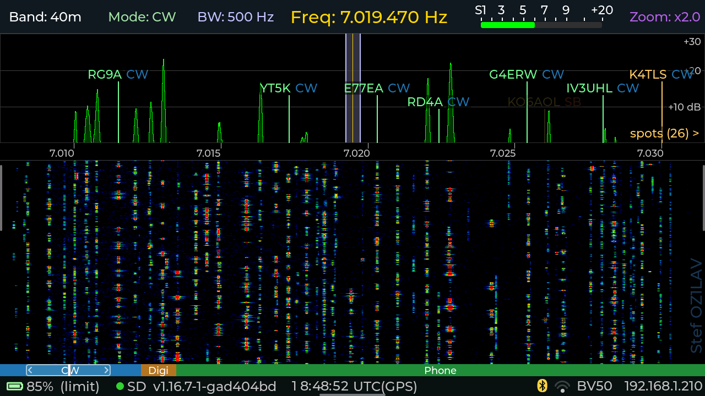
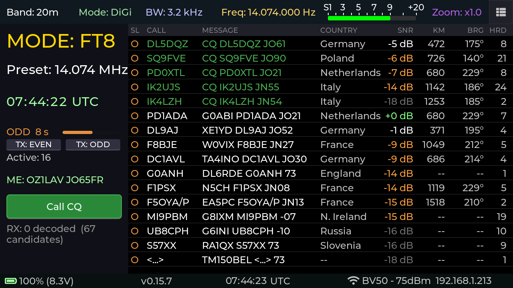

# QMX+ Panadapter

*By Steffen Lav (OZ1LAV).*

A standalone real-time panadapter — spectrum analyser and waterfall — for the [QRP Labs QMX/QMX+](https://www.qrp-labs.com/qmxp.html) HF transceiver, running on the [M5Stack Tab5](https://docs.m5stack.com/en/core/tab5) (ESP32-P4 with a 5" 720×1280 touch display).

The QMX exposes I/Q audio over USB UAC plus CAT control over USB CDC-ACM. The Tab5 connects to the QMX as a USB host, decodes the I/Q in real time on the ESP32-P4, and renders a touch-driven panadapter with tap-to-tune, pinch-zoom, onboard FT8/FT4/JS8 decoding and transmit, ADIF logging, and a matching browser web UI.

**Documentation:** [tab5.lav.dk](https://tab5.lav.dk) — the user guide, quick-start, and reference as plain web pages. A more approachable read than this page if you just want to set the device up; the source code and release downloads stay here on GitHub.



*40 m CW, zoomed x2 around 7.019.470 MHz, with RBN/DXC spots labelled directly on the trace (v1.16.7). The spectrum trace tracks a per-bin noise floor so real signals pop sharp above a calm baseline. Top bar: band, mode, bandwidth, centre freq, S-meter, zoom. Bottom bar: battery, SD, firmware version, UTC clock, WiFi, callsign, IP. The same view streams live to any browser on the LAN — see [Web UI](#web-ui).*

> **Release — v1.17.1.** A complete, self-contained FT8/FT4/JS8 station: spectrum and waterfall, on-device decode and transmit, automatic QSOs, ADIF logging, and upload to **four logbooks — QRZ, eQSL, ARRL LoTW and your own Cloudlog or Wavelog** — with no PC in the loop. It runs offline for POTA/SOTA, streams to any browser on the LAN, and carries its own user manual inside the firmware.
>
> ⚠ **Switch your QMX on only after the Tab5 has settled** — once the spectrum is running and WiFi shows a network. Powering the radio while the Tab5 is still starting leaves it short of memory for the whole session, which can make the web interface unreachable. See [Quick Start](docs/mkdocs/quick-start.md).
>
> **What changed in earlier releases** is in **[docs/version-history.md](docs/version-history.md)** — every release from v0.1.0 onward, newest last. The section below describes what the firmware does **today**, not what any one release added.

Prefer a single printable file? [Download the User Guide PDF](docs/QMX-Panadapter-UserGuide-v1.17.1.pdf).

<!-- USERGUIDE:START -->

The full documentation also lives online at **[tab5.lav.dk](https://tab5.lav.dk)** — the user guide, quick-start, and reference as searchable, cross-linked web pages, kept in sync with every release.

---

## Features

Everything below is in the firmware **today**. Nothing here needs a PC, and only the
items marked *(needs WiFi)* need a network.

### See the band

**Real-time panadapter** — Spectrum and waterfall across a 48 kHz window centred on the
QMX VFO, at 30 Hz, with 12 kHz IF-offset compensation. Tap or drag to tune (mode-aware
snapping), pinch to zoom ×1–×24 with a true zoom-FFT, one-finger drag to pan and retune.
Adaptive per-bin noise floor, flat-spectrum mode, adjustable waterfall black level and
contrast, selectable FFT window, and a graphical S-meter calibrated in dBm. A colour
band-plan strip tracks the VFO (IARU region 1/2/3, auto-selected from your grid) and can
be dragged to scrub across the band.

**A spectrum that holds still** — From ×2 zoom up, the spectrum and waterfall stay where
they are and the VFO marker moves across them, so a signal stays put on screen while you
tune towards it and the waterfall's history stays lined up under the frequency it belongs
to. It really does hold still: the picture never slides along with the dial. Tune far
enough and your filter passband reaches the screen edge, keeps going, and once about half
of it has slid off the display pages in one step, carrying part of the old screen across.
The trigger is your filter passband rather than a percentage of the view, so it behaves
the same in every mode. Tapping a spot moves only the marker when the spot is already on
screen, and re-frames when it is not. On by default, and switchable. At ×1
the view stays centred on the dial, because the view is already the whole 48 kHz the radio
sends. The band above dial+12 kHz is hatched on both screens — the radio genuinely cannot
hear it, and drawing something there would be inventing signal.

### Hear the band

**Audio, and binaural CW** *(beta)* — The I/Q the radio already sends is turned into sound
on the device. The **panoramic CW split** places two stations on different frequencies to
the left and right of the stereo image instead of letting them land on top of each other,
with **pan width**, **pan blend** and **overlap** adjustable live while you listen. This
plays to something your ears do far better than any decoder: separating two sources by
where they are coming from. A single-channel reader has to pull both signals out of one
waveform; binaural CW hands the job to the part of your hearing that evolved for it, and
two stations calling together stop being a jumble. Best at **300 Hz bandwidth and up** —
**below 200 Hz there is little separation to be had**, because the signals then share too
much of the audio passband for any amount of panning to pull them apart. Audio competes
for resources, so open **Audio Settings** from the settings drawer, where it is switched
on and off. This is a first implementation and is
**beta**, with the same features planned for the web interface — sending only the I/Q to
the PC and doing the work there. See [Audio](docs/mkdocs/guide/audio.md).

**Receive from the 3.5 mm jack** *(beta — Tony, @tony1tf, #17)* — The panadapter can take
its signal from the Tab5's own headphone jack instead of the radio's USB audio. Tony asked
for an audio input for digital modes and then ran a test build on his own Tab5 to find
where the jack lands: the mic ring arrives on the audio chip's third channel, which is the
fact the feature is built on. The jack is one real audio channel, not I/Q, so the second
channel is synthesised by a 255-tap filter that builds the quadrature pair the decoders
need. There is a level meter, a clip indicator and the jack wiring drawn on screen.
⚠ **No signal has been decoded through it yet** — the path runs and the levels read
correctly, and that is the whole of what is proven. ⛔ In this mode the USB radio
connection is off by design, so CAT, the S-meter and the band/mode display go quiet.
Changing the source needs a restart, which the Tab5 performs itself on **Save**.
See [Audio](docs/mkdocs/guide/audio.md).

**Decoded CW** ** — In CW or CW-R, a line along the bottom of the
panadapter shows the Morse the radio is decoding, with an estimate of the sending
speed. The **QMX does the decoding itself** and hands the text over CAT, so it costs
the panadapter no processing at all and does not touch the spectrum or FT8. Works on
QMX firmware 1.03 and later, on the Tab5 and in the browser, and switches off in the
settings drawer under Radio *(suggested by Uwe DL8UG)*. With a card in the slot it is
also written to `qmx-panadapter/cw-decode.txt` with timestamps, so a half-caught
callsign can be resolved afterwards *(Michael K Johnson KZ4LY)*.

### Tune and control the radio

**QMX CAT control** — Live frequency, mode (USB/LSB/CW/DiGi, plus AM on QMX firmware
1.04+), SSB filter bandwidth, CW passband, passband overlay, TX power and SWR readout,
QMX volume in decibels matching the radio's own display, and an Antenna Tune button on
1.04+. Round-trip CAT latency under 50 ms. Band presets with per-band frequency recall,
and 32 memory channels in a 4×8 grid holding any frequency and mode.

**RIT** — Pull in a caller answering off your frequency without moving transmit: arm it,
tap the caller, and a marker shows where you are listening while the gold line goes on
meaning the dial. A long press parks the offset and restores it.

**Radio menus** — The QMX's own 80×24 menu system, on the Tab5 and in the browser, over
the radio's *second* USB serial port so the panadapter keeps decoding while you are in
there. For a QMX+ with no control panel it is the only way in. Leaving hands the radio
back properly and restores your frequency and mode.

**CW keyer speed** *(Ralph Hellmig)* — A slider in the settings drawer directly above IF
calibration, and the same control on the web page. It sets the radio's keyer speed over
CAT and then shows what the radio actually took, because the radio is the authority here
and does not store the value itself. ⛔ **A speed of 0 means a straight key**, not "no
speed set". See [Radio Menus](docs/mkdocs/guide/radio-menus.md).

**Touch, keyboard, mouse** — Edge-swipe navigation with breathing grip handles, an
on-screen keyboard, and optional support for the M5Stack Tab5 70-key snap-on keyboard —
which drives the radio's own menus, works in every window with buttons, scrolls the
settings drawer and the manual, and carries Ctrl shortcuts you can reassign yourself. It
can be attached or reattached at any time, not only at boot. A **Bluetooth keyboard** does
the same: every text box, Enter and Esc in every window, Tab between fields and the arrow
keys, with the on-screen keyboard stepping aside while one is connected. A keyboard and a
mouse can be connected at once, in either order. ⚠ Bluetooth keyboards are **US layout
only** — a Bluetooth keyboard reports key *positions* rather than characters, so letters,
digits, Enter and the arrows are right on any keyboard while punctuation on a non-US
layout will not be. Plus USB mouse support. *(The mouse and the QMX cannot share the single USB host port — the
ESP32-P4's USB stack lacks the Transaction Translator a hub would need — so the mouse is
for setup, log review and reading the manual with the radio unplugged.)*

**Bluetooth mouse** — A pointer that works *while the QMX stays plugged in*, which a USB
mouse cannot do on this hardware. Pair once; it reconnects by itself. Move, click, and a
wheel that scrolls whatever is under the pointer — **and over the spectrum or waterfall,
that wheel tunes**: 10 Hz a click in CW and the digital modes, so a signal can be
zero-beaten by ear, and 100 Hz in SSB *(Roy KI0ER, John Dusek)*. It stops at the band
edges, and anything on top of the panadapter — a modal, the settings drawer — takes the
wheel instead, so the dial never moves under something you are reading.
**The mouse must be Bluetooth 4.0 or
later (Bluetooth Low Energy).** The Tab5's Bluetooth comes from a co-processor with no
Bluetooth Classic radio, so an older Classic mouse cannot work and no firmware change can
help — it never appears to the Tab5 at all. Most mice sold since about 2014 qualify; a
dual-mode mouse works on its Low Energy channel.

### Work the digital modes

**FT8 and FT4, receive** — Continuous on-device decoding in the same view as the
panadapter: FT8 (15 s slots) and FT4 (7.5 s slots). **JS8** is a third sub-mode of this
page - see below. The decode list shows callsign,
country, signal report, slot-timing offset (DT), audio tone (HZ), distance and bearing,
with the station you are working held at the top. Include/exclude filters match anything
in the message text, worked-before stations can be excluded band-by-band, and a pileup
tracker collects everyone calling you.

**FT8 and FT4, transmit** — Tap a station and the correct *next* message is sent
(WSJT-X double-click style); or call CQ from one of three editable presets, with an
optional stop-after-N-calls limit. Full automatic exchange through to `73` and an ADIF
entry, a resend if your partner never heard your final, a polite hold for a station
already working someone else, grey-listing for stations that never answer, and an
optional unattended auto-answer robot. Your TX tone is a permanent on-screen button with
a live occupancy strip, drag-to-pick tone selection, **TX Hold**, and a cycling
**TXCQ ANY / EVEN / ODD** time-window choice. ARRL Field Day exchange mode included.

**JS8 — a keyboard mode, on the device** *(beta)* — JS8 carries **free text** on FT8's
modulation, so stations hold short conversations rather than trading a fixed exchange.
All of it runs on the Tab5: sync, LDPC error correction and the CRC check on receive, the
encoder and transmitter on send. It is a sub-mode of the FT8/FT4 page - pick **JS8** in
the preset picker - and adds a **Conversation** tab beside **Stations**, so you can read
what has been said as well as who is on the band. To send, tap **Free text** under Call
CQ, or use the composer on the web page; both report how many frames the message takes
and how many seconds it holds the frequency before the radio is keyed. Directed messages
and heartbeats are shown with the sender's callsign and grid. Full detail in [JS8](#js8).

**WSPR** — A third page, reached by the same swipe: **Panadapter → FT8/FT4/JS8 → WSPR**. WSPR
is a propagation beacon rather than a contact mode — a very slow, very weak signal
carrying only your callsign, grid and power, which stations worldwide report hearing, so
over an evening you get a picture of where your antenna and your band actually reach at
levels where nothing else would be heard at all. Nobody replies and nothing goes in your
log. The page lists what was heard each two-minute cycle with the band, distance and
bearing, and the furthest of the session. Receiving is the default; transmitting is opt-in, refuses to
key without your callsign and grid, and has a transmit schedule and optional band hopping.
**Calibrate Power** sweeps *Max. PA voltage* on a dummy load and measures real RF output
at each step, per band. **Declared power** then only offers the standard WSPR dBm steps
your calibration actually reaches — each one labelled with its real measured wattage, not
a textbook figure — so what you declare (published worldwide with every spot) matches
what actually goes out. A WSPR transmission keys the radio for about 110 seconds in every
120, so picking a low declared level for long beacon runs is how you protect the finals
now, rather than a fixed voltage cut applied underneath you. **Output power**, a separate
slider for every other mode (FT8, CW, SSB, ...), shares the same calibration but stays out
of WSPR's way entirely — Declared power always owns the radio there. What you hear can be
published to wsprnet.org *(needs WiFi)*.

### Who is out there, and who hears you

**Live spots on the spectrum** *(needs WiFi)* — **POTA** park activations, and optionally
**RBN** CW skimmer spots and **DX cluster** spots, drawn onto the trace at the frequency
the station is actually using. The cluster is where phone activity comes from — skimmers
are machines, and no machine recognises a callsign spoken into a microphone. One station
is one entry, however many sources report it. Grey means you have already worked them on
that band. Press and drag to pick one, lift to tune it *with the right mode*. Spots fade
with age and are gone after 30 minutes; corner counts take you to the ones just off-screen.

**Knowing you are getting out** *(needs WiFi)* — **Who is hearing me** asks PSK Reporter
which receivers have copied *your* call, with distance, bearing and the report they gave
you. **SWR protection** cuts a transmission short and latches the transmitter off above
your chosen limit, because an FT8 burst is thirteen seconds of key-down into whatever the
antenna is doing.

**PSK Reporter spotting** *(needs WiFi)* — The stations you decode are reported to
[PSK Reporter](https://pskreporter.info) the way WSJT-X does, so you appear on the map as
a monitoring station. **On by default**; sends your call and grid plus each decoded
station's call, grid, frequency, report and mode, batched at most once every five
minutes — over the internet only, **never on the air**. One checkbox turns it off, and it
is inert until your callsign and grid are set, and in simulation mode.

### Log it and confirm it

**QSO logging and upload** — Every contact is written to an ADIF log on the device, with
timestamp, callsign, grid, frequency, band, mode, both signal reports and distance
(never a report that was not actually exchanged). Read the log on the Tab5 or in the
browser, delete single records or all of them, and upload *(needs WiFi)* to **QRZ
Logbook**, **eQSL**, **ARRL LoTW** and **your own Cloudlog or Wavelog** — LoTW QSOs are
signed on the device itself with your own callsign certificate. A signal report or a
park/summit reference can be corrected after the fact from the browser's log table. The
browser's **ADIF restore** merges a previously downloaded (or any logger's) ADIF file
back in — contacts already logged are skipped — so an erase-and-reinstall does not cost
you your worked-station history. Or **restore straight from the microSD card**, on the
Tab5 itself with no computer at all. **Search the log** on either screen — by callsign,
country, band, mode, date or park — and in the browser **tick rows and export just
those** as their own ADIF file.

**Activation logging** — Start a **POTA** or **SOTA** activation and every contact is
stamped with the reference as it is logged, counted against the threshold, with chases
tagged from spots already seen and a single-reference ADIF export for uploading.

### Run it from somewhere else

**Web UI** *(needs WiFi)* — The whole panadapter in any browser on the LAN: live
spectrum and waterfall at ~10 fps, click or drag to tune, mouse-wheel pan and tune,
band/mode/bandwidth/zoom control, a graphical S-meter and the whole-band plan strip. In
FT8/FT4 mode it shows a live TX status banner and a **Call CQ** button instead of the
stream. Also: the QSO log as a sortable table, config download/upload as an editable text
file, a microSD file browser, screenshots, and the diagnostic log.

### Know what time it is

**A GPS of your own, and a sky view** — Two receivers work, and both are confirmed on
hardware: an **M5Stack Unit GPS v1.1** on PORT.A
and a **Module GPS v2.1** on the 30-pin M-Bus. Either gives you UTC **and the full date**
with no internet and no radio — every other offline source on this device gives a time of
day only, so the day itself was always a guess. Your station grid fills itself from the
fix, and never overwrites a grid you typed by hand. **GPS Stats** is a page of its own
under Radio in the drawer and on the web: the satellites in use drawn on an elevation-ring
sky view, with the fix, the satellite count and which receiver is answering. The clock now
also says whether the time came from a GPS on the Tab5 or from the radio.
See [Time sync](docs/mkdocs/guide/time-sync.md).

**Time and date, with or without a network** — SNTP when WiFi is up *(needs WiFi)*, the
Tab5's own supercap-backed RTC across power-off, the QMX's clock as an offline fallback,
GPS detected and phase-locked automatically if your QMX has one, and a manual
set-and-sync panel. FT8/FT4 timing also self-corrects from the decoded band consensus
when offline.

### Keep it working

**Updating from the device** *(needs WiFi)* — A new release is fetched quietly in the
background and offered once, in a window in the middle of the screen, with **Restart now**
or **Later**. Nothing is ever installed without you asking, and the automatic download can
be switched off if you are on a metered connection. The spectrum, waterfall and FT8
decoding keep running throughout.

**Built-in user manual** — This entire guide is compiled into the firmware, so it opens
instantly with no WiFi, no card and no download, and can never describe a different
version than the one you are running. It opens at the chapter for the screen you are on,
warning banners are tappable, and a **Need guidance?** panel lets you pick your symptom
in plain words. See [Getting help](#getting-help).

**microSD station backup** — Insert a card (a plain FAT32 32 GB card is ideal) and your
whole station is mirrored to `/qmx-panadapter/`: the ADIF log, a
full config export, your LoTW certificate and key, the diagnostic log and a
self-describing `README.txt`. Continuous with WiFi off; one complete backup per start-up
with WiFi on, because the card and the WiFi co-processor share a bus. The **SD** dot is
green while writes are reaching the card and yellow when nothing has landed lately. It restores too, which is the half that was missing: **Restore
from SD** in the Tab5's own log window, or from the browser. And because the card mirrors
the *present*, the copy from just before the log last got **smaller** is kept beside it as
`qso.prev.adi` — so a deletion you notice two restarts later is still recoverable.
**After inserting the SD card your Tab5 needs a restart** — the card is claimed during a
short window early in boot, so one pushed in while it is running is not used until then.
*(The card holds credentials — WiFi password, QRZ/eQSL logins, LoTW private key — so keep
it physically secure.)*

**Diagnostics** — An always-on diagnostic log, nothing to enable: 5 MB in RAM, a rolling
copy in flash that survives a power cut, and a full mirror to microSD if a card is in.
Downloadable from the browser or over USB serial. **A crash survives the reboot** — if the
Tab5 ever restarts unexpectedly, the next boot records what happened, in which part of the
firmware and how far into the session, so a diagnostic download is enough to answer it.

**Practice mode** — A simulator with phantom stations that call CQ and reply through the
real encode/decode pipeline, so you can rehearse a full QSO with **no radio connected**
— and with a hard interlock that never keys a QMX even if one is attached.

**Settings you decide the shape of** — Every setting appears on the Tab5 and in the
browser, and the drawer has a **Basic** and an **Advanced** view. Which sections appear in
which is yours to set, from a **Tab5 config** button in the web UI's Settings window; a
firmware update that adds a setting shows it rather than hiding it behind a layout saved
before it existed.

**Frequency format** — The frequency readout, preset buttons, WSPR band picker, keypad
and spectrum scale can be punctuated `14.074.000` (the default, and what the QMX shows
on its own LCD) or `14,074,000` *(Don N2VGU)*. Settings drawer, under Advanced.

### The hardware it runs on

**Built for the field** — WiFi is entirely optional, and can be given a static address if
you want the browser bookmark to keep working; battery percentage with a charge limit for
battery care; display sleep and a 180° flip for awkward mounting; config backup and
restore as a text file; and a settings reset that does not need a reflash.
---

## Contents

- [Quick Guide](#quick-guide) — get on air in 10 minutes
- [Getting help](#getting-help) — the manual on the device, and the guidance panel
- [Panadapter](#panadapter) — spectrum, waterfall, zoom, touch-to-tune, S-meter, memory channels
- [Live spots](#live-spots) — POTA, RBN and DX cluster callsigns drawn on the spectrum
- [Spot map](#spot-map) — who is hearing YOU: RBN, PSK Reporter and WSPR reports of your own signal, on a world map
- [Web UI](#web-ui) — browser panadapter and remote control
- [FT8 Receive](#ft8-receive) — onboard decoder, decode list
- [FT8 Transmit](#ft8-transmit) — reply, CQ-run, auto-QSO, ADIF logging
- [JS8](#js8) — keyboard mode on the device: decode, free text, CQ (beta)
- [Time sync](#time-sync) — Unit GPS on PORT.A, WiFi/SNTP, Tab5 RTC, POTA/offline use
- [Settings](#settings) — every drawer control, group by group
- [WSPR](#wspr) — two-minute propagation beacon: where your signal actually goes
- [Radio menus](#radio-menus) — the QMX's own menu system on the Tab5
- [Troubleshooting](#troubleshooting) — symptoms, causes and what to do
- [Reference](#reference) — gestures, web API, hardware
- [Build from source](#build-from-source)
- [Under the hood](#under-the-hood) — DSP, I/Q correction, quirks
- [Roadmap](#roadmap)
- [Related projects](#related-projects)

---

## Quick Guide

### Step 0 — Check your QMX firmware first

Power the QMX on by itself and read the firmware version off its own display at boot. You need **1.03.002 or newer**. If yours is older, update the QMX *before* connecting the Tab5 — everything that follows depends on it. This takes 10 seconds to verify and saves hours of debugging. Everything from **1.03.002** up to and including **1.04.010** works with the panadapter; on 1.04 the Tab5 additionally offers **AM mode** and an **Antenna Tune** button (SWR tune with a live power/SWR readout) — both stay hidden on 1.03.002, so there's no downside either way.

**Do not use 1.04.011 (19-Sep-2026) yet.** One operator reports no transmit output when the radio is keyed over CAT from the Tab5, and others report the radio's own Tune SWR and Hardware Test screens freezing until power-cycled. All of it clears on 1.04.010. Reported to QRP Labs; this note will go when there is a fix.

### Step 1 — Flash the Tab5 firmware

Use the one-click flasher in [`tools/QMX-Panadapter flasher/`](tools/QMX-Panadapter%20flasher) (also attached to each [release](https://github.com/SteffenLav/qmx-panadapter/releases)):

1. Plug the Tab5 into your computer with a **USB-C data cable** — charge-only cables will not work.
2. Run the flasher:
   - **Windows** — double-click `flash.bat` (fetches esptool by itself on first run; nothing to install)
   - **macOS** — double-click `flash.command` (needs esptool once — `brew install esptool` recommended; `pip3 install esptool` often fails on recent macOS with an "externally-managed-environment" error). If macOS blocks the script, right-click → **Open**, or run `bash flash.command` in Terminal (no `chmod` needed).
   - **Linux** — `bash flash.command` (needs `pip3 install esptool`)
3. The flasher asks **normal or clean** (see below) — just press **Enter** for a normal flash.
4. Wait for `SUCCESS`. The Tab5 restarts on the new firmware.

**The firmware is already in the zip** — `bootloader.bin`, `partition-table.bin` and `qmx_panadapter.bin` sit next to the script, and those are what get flashed. Nothing is downloaded except `esptool` itself, once, if your computer doesn't already have it. So after the first successful run the flasher works with no internet at all.

**Normal vs clean flash.** Just before flashing, the flasher asks:

> *Type E for a CLEAN/ERASE flash, or just Enter for a normal flash*

- **Normal (press Enter)** — updates the firmware and **keeps** all your saved settings (WiFi, callsign, grid, memory channels, ADIF log). This is what you want almost every time.
- **Clean (type E)** — wipes the whole chip first, so **every saved setting is permanently erased**: WiFi name *and* password, callsign/grid, all memory channels, and the logged QSOs. Use it only if something is stuck or corrupted (e.g. WiFi refuses to turn on no matter what). Back up first with **Config ↓** (below) so you can restore in seconds afterwards.

**If the flash keeps failing, reboot the Tab5 and try again — before anything else.** The Tab5's USB serial connection is produced by the ESP32-P4 itself rather than by a separate USB chip, so a busy running firmware can leave the COM port listed in Windows Device Manager while it no longer answers the flasher. A reboot clears it. After that, the usual causes are a charge-only cable or a serial monitor still holding the port. *(Samuel W7STF, after a 7-hour session.)*

Building from source? See [Build from source](#build-from-source).

### Step 2 — Connect the cables

You need **two** USB connections, and the cable to the QMX is the one people get wrong:

| Connection | Port on Tab5 | Cable | Carries |
|------------|--------------|-------|---------|
| **Tab5 → QMX** | **USB-A** (host) | **USB-A → USB-C, full data cable** | I/Q audio (UAC) + CAT (CDC-ACM) |
| **Tab5 → power** | **USB-C** | Any USB-C power cable (5 V / 2 A+) | Power |

> **The #1 failure is a charge-only cable.** Many USB-C cables — especially thin ones bundled with phones and chargers — carry power only, no data lines. If you use one between the Tab5's USB-A port and the QMX, the Tab5 powers the QMX but sees no audio and no CAT: the spectrum stays flat and the top bar shows `Band: ---`. Use a cable you know does data (one that works for a USB stick or phone file transfer). When in doubt, swap the cable first.

**Power-on order matters.** Turn the **Tab5 on first** and let it finish loading, then turn the **QMX on**. Within a few seconds the top bar should populate Band / Mode / BW and the spectrum should come alive.

Once flashed you can power the Tab5 from any 5 V/2 A USB-C source or the internal battery — the laptop is only needed for flashing. For diagnostics the Tab5 also outputs a serial log over the USB-C data connection (useful if WiFi is not available), but for most users the built-in **diagnostic log** — always on, nothing to enable — is the easier path — see [Step 7](#step-7--something-not-working).

### Step 3 — Find your way around

The whole app is driven by **one-finger swipes from the screen edges** and **taps on the top bar**. The settings drawer is always one swipe away — no hunting for hidden menus.

| Gesture | From | Does |
|---------|------|------|
| Swipe → | Left edge | Cycle Panadapter → FT8/FT4/JS8 → WSPR |
| Swipe ← | Right edge | Open settings drawer |
| Swipe ↑ | Bottom edge | Open memory channel picker |
| Tap or swipe ↓ | Any top-bar item | Open that item's selector |

Slim "breathing" grip handles on each edge show where to swipe — faint enough not to clutter the display, visible if you look for them.

The top bar reads **Band · Mode · BW · Freq · Signal · Zoom** left to right. Tap any item to open a selector — **Freq** opens the frequency keypad; **Mode** switches USB/LSB/CW/DiGi; **BW** selects SSB filter width (USB/LSB only); **Band** jumps to a configured band; **Zoom** selects a zoom preset.

See the [full gesture table](#gestures) in the Reference section.

### Step 3b — Choose FT8 or FT4 mode

FT8 is available on all HF bands; FT4 is available on select bands with published frequencies (20 m, 30 m, 40 m, etc.). To switch between them:

1. **In Panadapter mode:** Tap the **Mode** selector in the top bar, then choose **DiGi** (the digital mode group).
2. **In FT8 screen:** Tap the **Preset** frequency button to open the band/mode picker — you'll see **two columns**: FT8 (gold header) on the left, FT4 (cyan header) on the right. Tap any frequency in the FT4 column to switch modes.

The decode list, TX controls, and slot timing (countdown bar, which-parity-next) all adapt automatically to the active mode. Switching modes clears stale decodes from the previous mode so you don't work old QSOs.

**When to use each mode:**
- **FT8** — Most populated band in SOTA/POTA; longer decode window gives more time to prepare replies on slow links or weak signals.
- **FT4** — Faster QSO cycle for busy bands (Field Day, major contests, 20 m pile-ups) and operators who prefer shorter waits between exchanges.

### Step 4 — Fill in your settings

**On first boot the Tab5 opens a setup prompt automatically** — it will ask for your callsign, grid square, and WiFi credentials before you reach the main screen. You can skip any field and fill it in later via the settings drawer.

To open the settings drawer at any time: swipe in from the right edge, or tap the right grip handle.

- **WiFi** — enter your SSID and password. Recommended for everyone: you get accurate UTC time (needed for FT8 slot timing), the browser web UI, and remote diagnostics. The **WiFi initiated** checkbox below the WiFi section is an on/off master switch — uncheck it for POTA or field use with no network.
- **Identity** (callsign + grid square) — *only required for FT8/FT4 transmit*. Enter your callsign and Maidenhead grid (4 or 6 characters, e.g. `JO45` or `JO45ab`). The grid also drives the distance and bearing columns in the FT8 decode list.

Everything else — dB range, smoothing, colour map, brightness, IQ balance — has sane defaults. Adjust if you want to, but you don't need to on first use.

### Step 5 — Using the panadapter

Switch the QMX to any band and watch it come alive. This is the foundation of the device regardless of which modes you operate.

**Tap or drag to tune.** Touch anywhere on the spectrum or waterfall to place the cyan cursor. Drag and it snaps to a mode-aware grid — 10 Hz steps in CW, 250 Hz in SSB, 500 Hz for FT8/FT4 — so you can land precisely on a signal before lifting your finger. Lift, and the QMX retunes.

**Swipe fast to pan instead.** A quick horizontal swipe (rather than a held drag) slides the whole view left or right and retunes to wherever you let go — the fastest way to slide along a band. See [Touch-to-tune](#touch-to-tune) for exactly how the two gestures are told apart.

**Or move precisely with the band-plan slider.** For a controlled move rather than a quick swipe, drag the framed "visible window" on the band-plan strip (along the bottom) to exactly where you want to be on the band — the spectrum, waterfall, and VFO all follow it, so you can place yourself precisely on a segment before you even tap a signal.

**Zoom in on a crowded band.** Pinch with two fingers to zoom up to ×24. On a CW band at ×8 or higher you can resolve individual signals a few hundred Hz apart, read the spacing between callers, and pick your target before you tune. The frequency axis scales with you, down to Hz precision at high zoom. Double-tap anywhere to reset to the full 48 kHz view.

**Find your place on the band.** The thin band-plan strip along the bottom of the screen (just above the status bar) colour-codes the CW/Digi/Phone segments around you — pick your IARU region (or leave it on Auto) in the settings drawer → **Band-plan region**. The framed window on the strip is a **slider**: drag it (or tap anywhere on the strip) to move precisely to any spot on the band, and the spectrum, waterfall and VFO all follow along. You can also grab that slider from anywhere along the bottom status bar and drag sideways — a taller target — while a vertical up-swipe there still opens memory channels.

**Read your passband.** Two grey vertical lines on the spectrum mark your current filter edges. The BW label in the top bar shows the active width; tap it to choose 2.5 / 2.7 / 2.9 / 3.2 kHz in USB or LSB. A coloured tint fills the passband so you can always see exactly what slice of the band you're receiving.

**Watch the S-meter.** The Signal field in the top bar is a live tick-scale bar (S1 through S9+20), driven by the actual signal under your VFO cursor.

**Flat-spectrum mode.** Toggle **Flat spectrum** in the settings drawer to switch from absolute dBm to dB-above-local-noise-floor. Noise collapses to a calm baseline; real signals — including weak CW tones in the mud — pop sharply above it. Recommended on noisy bands.

**Save your spots.** Swipe up from the bottom edge to open the memory channel picker — a 4×8 grid of 32 channels. It doesn't greet you with blank cells: a fresh device arrives with a handful of **example channels already filled in**, and each one is **colour-coded by mode** (CW green, DiGi teal, USB brick-red, LSB purple) so you can read the whole grid at a glance without opening a single label. The very first time you open it, a quick **guided animation** walks you through the gestures — watch a channel slide to a new slot, then drop into the wastebin and vanish — so you learn "drag to move, drag to delete" in about ten seconds, once, and never again.

Then it's yours: **tap** a channel to recall it (the QMX retunes instantly), **tap an empty slot** to store the current frequency/mode, **long-press** to edit, **drag** a channel to reorganise the grid, and **drag onto the wastebin** (bottom-right cell) to delete it.

**Monitor from another room — or operate remotely.** Once WiFi is configured, open `http://<tab5-ip>` in any browser for a full-featured live panadapter with mouse-driven tuning, band/mode controls, and ADIF log download. The IP is shown in the bottom status bar. See [Web UI](#web-ui).

### Step 6 — FT8 (if that's your thing)

Swipe in from the **left edge** to switch to the FT8 screen. The Tab5 starts decoding 15-second slots immediately — no PC, no WSJT-X required.

1. Tap the **Preset** button and pick your band's conventional FT8 dial frequency (e.g. 14.074 MHz for 20 m).
2. Watch the decode list fill. CQ stations appear at the top sorted by SNR; exchanges and replies below.
3. To reply to a station: **hold your finger on their row** for ~250 ms. A dim highlight appears after ~80 ms so you can see which row you're targeting before the gate fires. Lift — a confirmation modal shows the exact message before anything is armed.
4. Tap **Auto Pounce** to hand the full QSO to the auto-engine (works through report → RR73 → 73 with patient retry), or **Transmit** for a single manual message.
5. To call CQ: tap **Call CQ**. The engine picks a clear audio slot, fires CQ, automatically answers the first caller, runs the full exchange, logs the QSO, and resumes calling CQ.

Every completed QSO is written to an ADIF log downloadable from the web UI. See [FT8 Transmit](#ft8-transmit) for the full picture, including ARRL Field Day exchange mode and a no-radio-keyed practice/simulation mode.

### Step 7 — Something not working?

**Spectrum flat, top bar shows `---`:**
- Check the cable between Tab5 and QMX — almost always a charge-only cable.
- Make sure the QMX is powered on and not stuck in its own bootloader.
- Power cycle in order: Tab5 first, then QMX.

**For anything else:**

1. The diagnostic log is **always on** — nothing to enable.
2. Reproduce the problem (let it run a minute; power-cycle the QMX if the issue is about connection).
3. Grab the log:
   - **Over WiFi:** in the web UI take **Files ▲ → Diagnostic download ↓**. That one item fetches **both** logs — `qmx-log.txt`, the current session held in RAM, and `qmx-log-saved.txt`, the copy persisted to flash that survives a reboot or a flat battery. If the device restarted, the saved one is the interesting file. (Directly: `/api/log` and `/api/log/saved`.)
   - **microSD:** if a card is inserted, the log is mirrored to `/qmx-panadapter/qmx-log.txt` on the card — continuously with WiFi off, or up to the start-up backup with WiFi on (alongside the always-on flash-persisted copy, which is complete either way).
   - **Over USB (no WiFi needed):** capture the serial console with `tools/capture_serial_log.ps1`.
4. Open an [issue](https://github.com/SteffenLav/qmx-panadapter/issues) and attach the log. It includes Tab5 and QMX firmware versions plus every CAT command exchanged — usually enough to pinpoint the problem immediately.

---

## Getting help

**This whole guide is inside the firmware.** No WiFi, no microSD card, no download: it works on the first boot, in a field with no signal, and it can never describe a different version than the one you are running. Swipe ← from the right edge to open the settings drawer; the top two buttons are the two ways in.

**User Manual — opens where you are.** Not a contents page to search: it opens the chapter covering the screen you were on — the panadapter chapter, the FT8 **receive** chapter, or the FT8 **transmit** chapter if a transmission is armed or running (someone mid-transmission is asking a different question). Inside: **Contents** is a two-column list — press and slide, and lifting your finger opens the highlighted chapter; **Back** returns to the previous page (shown only when there is one); **Exit** puts you back where you came from. Edge swipes and top-bar taps are stood down while the manual is open, so a stray touch cannot retune behind it. Holding the **User Manual** button for 3 s resets the reader; the manual itself is part of the firmware and cannot be lost.

**Need guidance? — describe the symptom, not the cause.** The second drawer button opens a short list headed *"What do you need help with?"*, written the way you would say it out loud — "My radio is not showing up", "Nothing appears in the decode list", "It never transmits", "How do I change what my CQ says?", "Where are my contacts logged?" Pick the one that fits and the manual opens at the section that answers it. The list holds questions as well as faults, and it scrolls — keep going past the first few rows.

**Rows the Tab5 can see are happening now are highlighted and floated to the top**: no CAT link to the QMX, IQ mode never confirmed, an empty decode list while FT8 is running with the radio present, or WiFi switched on but not connected. WiFi switched **off** deliberately — POTA, battery — is not reported as a fault; that row stays as a normal question. **The device ranks, you choose:** a highlighted row is a suggestion, and it will never navigate for you on inference. The rows offered are scoped to the screen you opened the panel from, so FT8 never offers you spectrum symptoms.

**Warnings you can tap.** A warning you cannot act on is half a warning. The red **"QMX IQ mode not confirmed"** banner across the top of the screen is a button — tap it for the section on that exact fault. The **"Waiting for QMX"** message carries a small **Need help?** button; it says *help* rather than *what is wrong* on purpose, since a radio that is off is often off deliberately.

If a chapter does not answer your question, that is a documentation bug worth reporting — the wording of these rows is written from what operators actually say.

---

## Panadapter

### Touch-to-tune

Tap anywhere on the spectrum or waterfall to place the cyan tune cursor. Drag and the cursor snaps grid-point to grid-point — you can see exactly which frequency will be tuned before you lift. The snap grid is **mode-aware**:

**Tune vs. pan — how your finger is read.** A quick horizontal swipe (more than ~70 px within 250 ms) pans the view instead of tuning — see [Zoom & Pan](https://tab5.lav.dk/guide/panadapter/#8-zoom-pan). A slower touch-and-hold (250 ms without that much movement) locks into tune mode, after which dragging moves the snap cursor as described below. In short: swipe fast to pan, hold-then-drag to tune.

| Mode | Snap step |
|------|-----------|
| CW / CW-R | 10 Hz |
| USB / LSB | 250 Hz |
| FT8 / DiGi / RTTY | 500 Hz |
| AM | 1 kHz |

The grid is anchored to absolute frequency (e.g. …200 / 300 / 400 Hz), not to your touch start point, so the cursor always lands on the same set of grid points regardless of where your finger first touches.

A floating frequency tooltip above the cursor shows the target frequency in real time while dragging. Lift → CAT `FA` command is sent and the QMX retunes. What the display does next depends on **Still spectrum**, below.

Taps always tune to exactly where you touched (snapped to the mode-aware grid above). The old **Snap to signal** option — which hunted for the strongest bin near your tap — was removed in v0.19.4; predictable tuning won.

**Passband indicator.** Two grey vertical lines mark your current filter edges. A faint coloured tint fills the passband. The amber VFO marker shows where the QMX is tuned; in CW mode it sits at dial + CW pitch offset so it marks the actual received tone frequency, not the suppressed carrier. The offset comes from the radio and is re-read every few seconds while you are in CW, so changing it on the radio is followed rather than leaving the display compensating by a stale figure.

**Still spectrum.** By default, from ×2 zoom up, the spectrum and waterfall **hold still and the VFO marker moves across them**, so a signal stays where you last saw it while you tune towards it and the waterfall's history stays lined up under the frequency it belongs to.

The display is never dragged along by the dial. It holds, completely, until it pages in one step:

| Where you are | What the display does |
|---|---|
| Your passband is inside the view | nothing moves — only the marker |
| Your passband reaches the screen edge | still nothing — it begins to slide off |
| Half a passband width past that | a page, carrying part of the old screen across |

Half a filter width is the whole allowance, and it is a deliberate compromise: long enough that a station right at the edge can still be worked, short enough that you are not tuning blind for long. How far you get between pages depends on your filter — roughly a screen-width less half a filter, so about 4.7 kHz of a 6 kHz view on a 2.7 kHz SSB filter.

**Tapping a spot** moves only the VFO marker when that spot is already comfortably on screen — the picture stays put, which is the point of the feature. If the spot is off screen, or so close to an edge that your passband would not fit, the display re-frames on it instead of leaving it stranded at the edge.

Switch it off under **Settings → Radio & display → Still spectrum**. At ×1 the view is already the whole 48 kHz the radio sends, so it stays centred on the dial.

**The hatched region.** The QMX's local oscillator sits 12 kHz below the dial, so the 48 kHz it delivers covers dial−36 kHz to dial+12 kHz — there is no data above dial+12, and that part of the display is hatched and inert. Before v1.10.5 it was filled by wrapping the bottom of the band into it and labelling it as dial+12 to +24, so tapping a signal there tuned you about 48 kHz away.

📖 Full chapter: [tab5.lav.dk/guide/panadapter](https://tab5.lav.dk/guide/panadapter/)

---

## Audio

*(beta)* The I/Q the radio already sends can be turned into sound on the Tab5
itself, with no extra hardware: **binaural CW**, which places two stations at
different points across the stereo image so your ears separate them the way
they separate voices in a room, and a **panoramic CW split** that pans the two
halves of the passband hard left and right.

This is the part of the panadapter that is not a picture. On a crowded CW band
it does something no amount of screen resolution can.

Full chapter: [tab5.lav.dk/guide/audio](https://tab5.lav.dk/guide/audio/)

---

## Live spots

Other stations drawn straight onto your spectrum at the frequency they are
actually using — **POTA** park activations, **RBN** skimmer reports, and **DX
cluster** spots, which are where phone activity comes from (no machine
recognises a callsign spoken into a microphone, so SSB is invisible to RBN).

Grey means you have already worked them on that band. Press and drag to pick
one, and lift to tune it with the right mode. One station is one entry, however
many sources report it. Each source switches on separately in **Network → Live
spots**.

📖 Full chapter: [tab5.lav.dk/guide/spots](https://tab5.lav.dk/guide/spots/)

---

## Spot map

Live spots answer "who can I work?". The spot map answers the other question:
**who is hearing me?** A full-screen map of the stations that reported *your*
signal — the CW skimmer that copied your CQ, the FT8 station whose decode of you
reached PSK Reporter, the WSPR receiver that logged your beacon — each a line
from your grid square to theirs. Contributed by **Uwe DL8UG**.

**Tap SelfSpotter in the settings drawer** (right below "Need guidance?") to
open it, from any page. Tabs for the map, a table of the same data, and HF band
conditions. Drag to pan, pinch to zoom around your own QTH. The LIST tab's
table is sortable: **RECEIVER, GRID, COUNTRY, MODE, BAND, FREQUENCY, SNR, KM**
and **AGE**. **GRID** is the locator the receiving station itself sent, so it
is blank for CW skimmers, which report a callsign and not a location.
**COUNTRY** comes from Uwe DL8UG's 18,365-prefix table and names the *country*
a spotting station belongs to, which can differ from the DXCC entity its own
marker uses on the map (Hawaii plots at its own coordinates but reads United
States in this column).

**Always running, no setting to find.** The feeds (RBN, PSK Reporter, wsprnet)
connect from the moment the Tab5 boots and stay connected the whole session —
there used to be an opt-in switch for this, dropped once it became clear the
map was worth having populated the moment you looked. Needs your callsign and
grid square.

📖 Full chapter: [tab5.lav.dk/guide/spot-map](https://tab5.lav.dk/guide/spot-map/)

---

## Web UI

With the Tab5 on WiFi, open `http://<tab5-ip>` in any browser - the IP is in the
bottom status bar. The browser panadapter is a view in its own right, not a
window onto the Tab5: more waterfall history on a big monitor, and a mouse,
which beats a finger for precise tuning.

It also carries the things that want a keyboard or a real screen - settings,
the microSD file browser, config backup and restore, ADIF upload, and a remote
power-cycle relay for the QMX.

Full chapter: [tab5.lav.dk/guide/web-ui](https://tab5.lav.dk/guide/web-ui/)

---

## Web API

Every control the browser page uses is a plain HTTP endpoint, so anything that
can make a request can drive the radio - a script, a macro pad, home
automation, or your own client. Tune, read status, pull the decode list, fetch
the ADIF log, stream the spectrum over a WebSocket.

Read-only to start with: `GET /api/status` tells you everything the bottom bar
knows.

Full chapter: [tab5.lav.dk/reference/web-api](https://tab5.lav.dk/reference/web-api/)

---

## FT8 Receive



*Live FT8 reception on 20 m. Left pane: mode, preset frequency, UTC, the slot
countdown with parity, your identity and Call CQ. Right pane: the decode list.*

Swipe in from the left edge to reach the FT8 screen. The Tab5 decodes 15-second
FT8 slots on the ESP32-P4 itself - no PC, no WSJT-X - and shows each station
with its country, distance, bearing and signal report.

FT4 is the same screen: pick it from the preset list and the slots become 7.5
seconds.

Full chapter: [tab5.lav.dk/guide/ft8-rx](https://tab5.lav.dk/guide/ft8-rx/)

---

## FT8 Transmit

Transmit goes out through the QMX's own `TA<freq>;` CAT command - no PC audio
path and no WSJT-X. The QMX does the synthesis and the envelope shaping; the
Tab5 sends the 79 tone commands.

Hold a row in the decode list and the panadapter builds the correct *next*
message for that station from what they last sent, the same semantics as a
double-click in WSJT-X. Hand the whole exchange to the auto-engine, or send it
a message at a time. A completed QSO logs itself to ADIF.

Full chapter: [tab5.lav.dk/guide/ft8-tx](https://tab5.lav.dk/guide/ft8-tx/)

---

## JS8

**JS8 Normal runs on the Tab5 itself** - decoder, error correction and transmitter, no PC. JS8 is a keyboard mode on FT8's modulation: it carries free text instead of FT8's fixed exchange, so stations hold short conversations.

Pick **JS8** from the **Preset** dropdown in the FT8 view - the dropdown is three wide now. Only **JS8 Normal** (15-second slots) is supported; Fast, Turbo and Slow are not, and Turbo is unreachable over CAT anyway.

With JS8 selected the right pane carries two tappable tabs: **Stations** (who is on the band, with grid and age) and **Conversation** (what has been said - AGE, Hz, CALL, MESSAGE). Both appear in the browser too.

⚠ **JS8 is new in v1.17.0 and declared a beta.** Receiving is proven on air, sending free text is proven on air, and a CQ from the Tab5 was decoded by a second station. **A full automatic two-way JS8 QSO has not been completed**, and compound callsigns are not handled.

**Sending free text.** Tap **Free text** under Call CQ on the Tab5 (JS8 only), or use the composer under the conversation pane on the web page. Both report how many frames the message takes and how many seconds it holds the frequency before anything is keyed, and show the normalised text the encoder will actually send - upper-cased, whitespace collapsed, unsendable characters dropped. One frame per 15-second slot, so a twelve-frame message is three minutes of transmitting. **Stop TX** aborts a run in flight and stays reachable while transmitting. Scriptable as `POST /api/cmd {"action":"js8_text","text":"..."}`, with `js8_text_plan` for the frame/second count without transmitting and `js8_text_cancel` to stop.

A free-text frame carries **no callsign** - that is JS8's design. The Tab5 names a message after a station that identified itself on the same audio frequency, and shows the **frequency instead of a name** when two stations are equally plausible. A wrong callsign on somebody else's words is worse than none.

Your grid goes on the air as **four characters** always: a six-character grid in a JS8 CQ is read by other stations as a callsign.

Full detail, including exactly what is and is not proven: the JS8 chapter of the user guide.

---

## Time sync

The Tab5 needs accurate UTC for FT8 slot timing. Sources in priority order (highest first):

| Source | When applied |
|--------|-------------|
| **Unit GPS (PORT.A)** | M5Stack Unit GPS v1.1, selected under **Settings ▸ Device ▸ Port mode** — satellite UTC **including the full date**, offline, ranked above every other source while it has a fresh lock |
| **GPS-equipped QMX+** | Auto-detected, no setting. Phase-locked to the radio's GPS second (~10 ms, drift-free) and, on radio firmware 1.04_004 and later, carrying **the date** as well — so an offline QMX+ with a sky view answers the date question by itself. As good as SNTP; re-locks every 5 minutes |
| **SNTP (WiFi)** | Always authoritative whenever WiFi is connected and has synced at least once — sets system clock, Tab5 RTC, and NVS |
| **Tab5 RTC** | RX8130CE supercap-backed (~30–40 h retention) — applied at boot before QMX or WiFi are available, and only when this firmware's own record agrees with it (see below) |
| **QMX `TM;`** (no GPS) | Offline fallback only — applied when WiFi is down or has never synced (field/POTA with no WiFi) |
| **FT8 signal timing** | Sub-second correction from the decoded signal population's average timing, auto-applied continuously every slot while FT8 is decoding (damped, so a noisy single slot can't yank the clock) — deliberately tracks who you're actually trying to work, not absolute GPS/NTP truth. A manual one-shot version is also available via the **Sync Time** modal (see below) |
| **Manual** | Full HH:MM override in the **Sync Time** modal — for rare POTA sessions with neither WiFi nor QMX clock |

Each accepted sync writes through to the RX8130CE so the clock persists across power-off. The Tab5 also polls the radio every 5 minutes in the background to catch QMX GPS lock events.

**The date is checked separately from the time, and the supercap clock is not taken on trust.** Every source above except the two GPS ones gives a time of day only, so a perfectly set clock can still log under the wrong day. The Tab5 asks **"Is today's date right?"** about a minute after it starts when it cannot establish the date itself. The RX8130CE still running is *not* proof: it says the battery held, not who last wrote it, and another firmware flashed onto the same Tab5 can leave a date decades out with the battery perfectly healthy. The clock is believed only when this firmware's own record backs it up, has not gone backwards, and is recent enough that somebody has plausibly been watching.

**For POTA / no-WiFi use:** uncheck **WiFi initiated** in the settings drawer. Time comes from the QMX on USB connect (or the supercap RTC if the Tab5 was recently synced). FT8 slot timing will be accurate from either source.

### FT8 time calibration modal

On the FT8 screen, tap **Options** → **Sync Time** to open the time calibration modal. It shows three large boxes: **\[HH\] : \[MM\] : \[SS\]**.

- **HH / MM** — pre-filled from the current UTC clock. Tap either box to edit it with a numpad. Use this for rare POTA situations where neither WiFi nor the QMX clock is available.
- **SS** — auto-syncs continuously from decoded FT8 signals. Each slot, every successfully decoded station contributes a timing sample; a robust outlier-rejecting average (median ± a tolerance window) across all of them sets the correction, so one bad decode can't throw off the reading. The box border flashes bright blue for ~30 ms each time a fresh measurement lands — a visual heartbeat that sync is active — and the hint below reads **"Flash: FT8 synced..."**. A blue frame means it is actively tracking; tap SS to lock it.
- **Apply** — if only SS was synced (HH and MM untouched), `time_sync_apply_correction_ms()` nudges the system clock by the measured sub-second offset and writes through to the RTC. If HH or MM was edited, `time_sync_set_manual()` sets the full time. The bottom bar shows **UTC(FT8)** after an FT8-derived correction, or **UTC(manual)** after a full manual set.

---

## Settings

The settings drawer, opened by swiping in from the right edge. It is grouped —
**Station, Device, Radio, Network, Display, FT8, WSPR, Spectrum** — with a
**BASIC / ADVANCED** button that keeps the list short until you need it to be
long. Which sections sit in which view is yours to set, from the web UI's
**Settings → Tab5 config**. Changes save themselves; there is no OK button to
hunt for.

📖 Every control, group by group:
[tab5.lav.dk/guide/settings](https://tab5.lav.dk/guide/settings/)

---

## WSPR

A propagation beacon rather than a contact mode: a very slow, very weak signal
carrying only your callsign, grid and declared power, reported by stations
worldwide. Swipe → from the left edge cycles **Panadapter → FT8/FT4/JS8 → WSPR**.
Receiving is the default and worth doing on its own; transmitting is opt-in.

**Calibrate Power measures what your QMX actually does, on your antenna
system, at every setting — instead of guessing from a rule of thumb.** From
the drawer (**Radio → Antenna Tune → Calibrate Power**, or "Calibrate this
band" the first time you open Declared power / Output power on an
uncalibrated band), it sweeps *Max. PA voltage* through 45 points on a
**dummy load** and records the real RF output at each with the QMX's own
`PC;` readback. Takes a few minutes per band; results are saved per band and
used from then on.

**Declared power** (the WSPR drawer) then only offers the standard dBm steps
your calibration actually reaches on the current band — no more picking
"37 dBm" and transmitting something else entirely. Each step's wattage is the
*real measured* figure, not the textbook one, so what you see is what goes
out and what gets published to wsprnet with every spot. A WSPR transmission
keys the radio for about **110 seconds out of every 120**, so this is also
where you protect the finals now: pick a low declared level for long beacon
runs, rather than relying on a fixed halving the firmware used to apply
underneath you. Anything above 1 W gets a plain warning instead.

**Output power**, a separate slider filed with Calibrate Power, does the same
job for every *other* mode (FT8, CW, SSB, ...) — it has nothing to do with
WSPR's own declared level and doesn't appear on the WSPR page, since Declared
power always owns the radio there.

📖 The full chapter:
[tab5.lav.dk/guide/wspr](https://tab5.lav.dk/guide/wspr/)

---

## Radio menus

The QMX's own menu system, on the Tab5's screen, over the radio's **second** USB
serial port — so CAT keeps running and the panadapter does not stop. Switch that
port on once, on the radio: **System config → GPS & Ser. ports → USB serial
ports → 2**. For a QMX+ with no control panel this is the only way into its
menus.

📖 The full chapter:
[tab5.lav.dk/guide/radio-menus](https://tab5.lav.dk/guide/radio-menus/)

---

## Troubleshooting

Symptoms, their causes and what to do about them — the QMX not appearing, no decodes, a
clock that is wrong, WiFi that will not hold, a card that stops being written.

> **On the Tab5 itself:** swipe in from the right edge and tap **Need guidance?**. It
> lists these symptoms in plain words, highlights the ones it can already see happening,
> and opens the manual at the matching section.

## Reference

### Gestures

| Gesture | Where | Effect |
|---------|-------|--------|
| Tap | Spectrum / waterfall | Tune to tapped frequency (snapped) |
| Touch + drag (hold ~250 ms first) | Spectrum / waterfall | Cyan cursor snaps grid-to-grid; tunes on release |
| Fast one-finger horizontal swipe | Spectrum / waterfall, any zoom | Pan/"stroll" the view; retunes to the new centre on release |
| Double-tap | Spectrum / waterfall | Reset zoom and pan to ×1.0 / centred |
| Pinch (two fingers) | Spectrum / waterfall | Zoom ×1.0–×24.0 |
| Two-finger drag | Spectrum / waterfall (zoomed) | Pan the zoomed window |
| Swipe → from left edge | Left edge strip | Cycle Panadapter → FT8/FT4/JS8 → WSPR |
| Swipe ← from right edge | Right edge strip | Open settings drawer |
| Tap right grip handle | Right edge | Open settings drawer (alternative) |
| Swipe → | Open drawer, or spectrum while drawer open | Close settings drawer |
| Swipe ↑ from bottom edge | Bottom edge strip | Open memory channel picker |
| Tap or swipe ↓ | Top-bar item (Band/Mode/BW/Freq/Zoom) | Open that item's selector |
| Touch and hold ~250 ms | FT8 decode list row | Dim preview at ~80 ms; full selection at 250 ms (scroll locks, drag moves highlight, lift to confirm) |
| Quick swipe | FT8 decode list | Scroll the list normally |

### Per-unit IF calibration

The QMX's +12 kHz IF injection varies slightly between units. If signals appear consistently shifted left or right of where the QMX is actually tuned, open the settings drawer → **IF calibration** slider (±100 Hz, persisted to NVS). Default 0. Reported by Ken KF0AYY, whose unit needed about −55 Hz to centre correctly.

### Hardware

- **M5Stack Tab5** — ESP32-P4 v1.3 (ECO2), ST7121 or ST7123 5" 720×1280 MIPI-DSI touch display, 32 MB PSRAM, ESP32-C6 co-processor for WiFi
- **QRP Labs QMX or QMX+** — firmware 1.03.002 up to 1.04.010 (1.04 unlocks AM mode + Antenna Tune; 1.04.011 is not recommended yet)
- **USB-A → USB-C data cable** between Tab5 USB-A host port and QMX (full data, not charge-only)
- **USB-C power supply** for the Tab5 (5 V / 2 A or better, or internal battery)

```
┌──────────────┐   USB-A → USB-C (data cable)   ┌─────────────┐
│  M5Stack     │ ──────────────────────────────► │   QMX+      │
│  Tab5        │   UAC: I/Q audio (48 kHz stereo)│             │
│              │   CDC-ACM: CAT control          └─────────────┘
│              │
│              │   USB-C (any power cable)       ┌─────────────┐
│              │ ──────────────────────────────► │  5 V source │
└──────────────┘                                 └─────────────┘
```

### What works without the QMX connected

| Works without QMX | Needs QMX connected |
|-------------------|---------------------|
| UI, settings drawer, gestures | Spectrum + waterfall (no I/Q = flat line) |
| WiFi, web UI, screenshots | Top bar Band / Mode / BW |
| Callsign / grid / WiFi credentials | Tap-to-tune, mode popup (CAT writes) |
| Brightness, colour map, dB range | S-meter, FT8 decode/TX, QMX firmware readout |

If the spectrum is flat and the top bar shows `---`, that is almost always the radio not being seen over USB — which loops back to the cable (or the QMX being off / in flash mode).

### Spectrum signal shifted / mirrored, tunable across the whole 48 kHz window

This means the QMX never confirmed IQ mode for the session — without it the radio streams plain (non-IQ) audio instead of a centred baseband, so the signal appears at the wrong place and slides across the full 48 kHz window as you tune. As of v0.19.3 the Tab5 retries the IQ-mode handshake automatically at connect (up to 4 attempts) and this resolves itself almost every time; if it still fails after all retries, a red banner appears across the top of the screen telling you so immediately, instead of leaving you to figure it out from a shifted waterfall. If you see the banner, power-cycle the QMX (forces a fresh handshake on reconnect) or check the QMX's own **System Config → IQ Mode** setting.

### Reporting hardware issues

Near the top of the boot log you will see:

```
I (xxxx) bsp_info: === TAB5 BSP INFO ===
I (xxxx) bsp_info: chip:     ESP32-P4 rev v1.3
I (xxxx) bsp_info: psram:    30 MB
I (xxxx) bsp_info: panel:    ST7123 (inferred from touch)
I (xxxx) bsp_info: touch:    ST7123 @ 0x55
I (xxxx) bsp_info: heap:     230.5 kB internal free, 28.80 MB PSRAM free
I (xxxx) bsp_info: idf:      v5.4.4
I (xxxx) bsp_info: firmware: v0.21.0
I (xxxx) bsp_info: =====================
```

When opening a hardware issue, paste this block — the `panel` and `touch` lines are the first thing needed to identify which Tab5 hardware revision you have.

> **Note on `reset_reason`:** a deliberate reset-button force-off returns `panic/exception`, not `external-pin`/`power-on`. A genuine firmware crash always prints a `Guru Meditation` register + backtrace dump immediately *before* the reboot. No backtrace = abrupt power-off, not a crash.

---

<!-- USERGUIDE:END -->

## Build from source

Requires **ESP-IDF v5.4.4** — pinned; do not upgrade. ESP32-P4 v1.3 silicon requires `CONFIG_ESP32P4_REV_MIN_0=y` and CPU capped at 360 MHz, both baked into `sdkconfig`.

```powershell
# Activate the IDF environment, then:
idf.py build flash monitor
```

Or with the `qmx` PowerShell helper — add to your `$PROFILE` and adjust the COM port:

```powershell
function qmx {
    param([string]$cmd = "fm")
    if (-not $env:IDF_PATH) { & C:\esp\v5.4.4\esp-idf\export.ps1 }
    switch ($cmd) {
        "b"   { idf.py build }
        "f"   { idf.py flash }
        "m"   { python -m esp_idf_monitor -p COM3 build\qmx_panadapter.elf }
        "fm"  { idf.py flash; python -m esp_idf_monitor -p COM3 build\qmx_panadapter.elf }
        "bfm" { idf.py build flash; python -m esp_idf_monitor -p COM3 build\qmx_panadapter.elf }
    }
}
```

Exit monitor: `Ctrl+T` then `Ctrl+X`.

---

## Under the hood

### I/Q balance correction

The QMX presents I/Q audio with a small but measurable amplitude imbalance and quadrature error between channels. Without correction, every signal produces a mirror image across the centre frequency (~30 dB weaker), cluttering the waterfall on a busy band.

A blind adaptive Gram-Schmidt orthogonaliser runs sample-by-sample in the audio pipeline before the FFT. It maintains running estimates of:
- **DC offset** on each channel (τ = 1 s)
- **Power** in I and Q (τ = 200 ms)
- **Cross-product** I·Q (τ = 1 s) — non-zero cross-product means the channels are not orthogonal

Correction per sample:

```
i_out = i
q_out = (q − K_phi · i) × K_amp
```

No calibration step needed; the estimator converges on ambient band noise within a few seconds of any signal. A two-speed startup runs all alphas at 8× for the first 2 s of real signal after each reset (effective convergence ~125 ms), then drops to steady-state. Toggle in the settings drawer; re-enabling resets the estimator so it reconverges from a clean state.

### Quirks and trade-offs

**PI4IO expander must be initialised before display bring-up.** The Tab5's PI4IO I/O expander holds `LCD_RST` and `TP_RST` low at chip power-on. Without explicit init, on a true cold boot the panel never comes out of reset and the DSI FIFO hangs. Soft resets mask this because the expander retains state across ESP32 resets. `display_init` calls `bsp_i2c_init()` + `bsp_io_expander_pi4ioe_init()` first, then waits 120 ms.

**Patched components in `components/`.** `espressif__usb_host_uac/` has `create_background_task = true` — required for UAC and CDC-ACM to coexist on the same USB host. `espressif__esp_lcd_touch_st7123/` makes `FW_VERSION_REG` the only mandatory register read (ST7121 NACKs the others and also adds a `max_touches > 10` bounds clamp). Do not replace either with the registry version without re-applying the patches.

**LVGL software rotation (~50% FPS cost).** The panel is natively portrait; landscape is achieved via `lv_display_set_rotation(LV_DISPLAY_ROTATION_90)`. Every flush goes through `rotate90_rgb565`. ~13 fps landscape vs ~22 fps portrait — acceptable for a panadapter. PPA hardware rotation conflicts with the USB host stack over DW-GDMA channels and silently kills UAC + CDC-ACM; do not set `CONFIG_LVGL_PORT_ENABLE_PPA=y`. A full native-portrait rewrite would recover the lost FPS but isn't planned — accepted as a permanent trade-off.

**IDLE watchdog disabled.** The LVGL rotation pipeline keeps CPU0 busy past the default watchdog window. `CONFIG_ESP_TASK_WDT_CHECK_IDLE_TASK_CPU0/CPU1` are off; the app-task watchdog (30 s) is still active.

**Cross-thread CAT writes must go through the poll task.** Writing CAT commands directly from the LVGL thread races the FA/MD/FW poll on the same CDC pipe — commands interleave and the QMX returns `?;`. Pattern: stash the request in a `volatile` and let `poll_task` drain it on its next cycle. See `s_pending_ssb_bw` / `cat_request_ssb_bandwidth()` in `cat.c`.

**SSB filter bandwidth needs three coordinated writes.** `MMSSB|Filter RX=<hz>;` commits the value (persists, shows in QMX menu); `MMSSB|Bandwidth=<hz>;` applies it live; `FW;` polling must be suspended while the width is pinned because reading the filter makes the QMX revert it. Dead ends: `FW<nnnn>;` CAT set returns `?;`; re-asserting the same mode digit does not reload the filter; `Bandwidth` write alone reverts on the next poll.

**HTTPS needs mbedtls allocating from PSRAM, not internal RAM.** The QRZ/eQSL upload features (v0.16.2) are this firmware's first-ever outbound HTTPS connections — SNTP, the only prior network client, is UDP. With the default `CONFIG_MBEDTLS_MEM_ALLOC_MODE=MBEDTLS_INTERNAL_MEM_ALLOC`, the TLS handshake's 16 KB+ buffers competed for the ~200 KB internal DRAM already under pressure from USB host/audio/FFT/LVGL and every connection failed with `ESP_ERR_HTTP_CONNECT`. Fixed by switching to `MBEDTLS_EXTERNAL_MEM_ALLOC` in `sdkconfig`, which moves those buffers into the 28 MB of free PSRAM instead.

### Project layout

```
main/
  main.c                    app_main, task launch, orchestration
  display/display.c         BSP bring-up (PI4IO + LCD + touch)
  ui/ui.c                   LVGL widgets, touch handler, canvases
  ui/ft8_screen_view.c      FT8 decode list, touch-drag row selection
  ui/ft8_tx_modal.c         TX confirmation modal
  cat/cat.c                 USB CDC-ACM + Kenwood CAT
  audio/audio.c             USB UAC + ring buffer producer
  dsp/dsp.c                 FFT, spectrum mutex, DC blocker
  dsp/iq_balance.c          Gram-Schmidt I/Q correction
  ft8_tx.c                  FT8 TX engine (build/arm/run/abort)
  ft8_test.c                FT8 slot loop (RX decode / TX burst)
  ft8_qso.c                 Auto QSO state machine
  ft8_sim.c                 FT8 simulation mode: phantom-station practice QSOs
  ft8_status.c              Mutex-protected FT8 status string
  adif/adif_log.c           ADIF QSO logging
  adif/qrz_upload.c         QRZ Logbook API upload (one record per request)
  adif/eqsl_upload.c        eQSL.cc upload (batched, multiple records per request)
  rtc/rtc.c                 RX8130CE supercap RTC driver
  time_sync/time_sync.c     Time sync orchestrator
  render/render.c           30 Hz render task, EMA smoothing
  render/render_waterfall.c Waterfall scroll (double-height canvas)
  screenshot/screenshot.c   RGB565 framebuffer capture for /ss.bmp
  storage/settings.c        NVS-backed settings with debounced flush
  wifi/wifi.c               C6 co-processor WiFi + SNTP
  net/webserver.c           HTTP server + WebSocket
  util/fps.c                FPS counter
  util/diag_log.c           Diagnostic log ring buffer (vprintf hook)
```

---

## Roadmap

The full per-version changelog — every release from v0.1.0 onward — lives in **[docs/version-history.md](docs/version-history.md)**. This section tracks only what's planned next.

### Next up

**v1.17.1 is here.** Next on the bench:

- **A full two-way JS8 QSO, unattended.** Receiving and sending free text are both proven on air; the automatic exchange that turns them into a QSO is not written yet. Compound callsigns go with it.
- **Web-UI audio streaming.** Listen to the receiver in any browser on your LAN — demodulated on the Tab5, no PC. Already working in development; held back for quality tuning and an overnight streaming soak. Server mode (screen off, device just serves) rides along.
- **CW page.** Canned-message CW TX memories first; decoded-CW display after (the QMX decodes internally — mirroring it over CAT looks cheap).

### Longer term

- **CW decoder.** Goertzel-based, text scrolling under the spectrum. The QMX already does this internally — question is whether to mirror its output via CAT or run a parallel decoder on the Tab5.
- **Extended waterfall history.** PSRAM has room for several minutes of scrollback; two-finger drag to scrub through history.
- **QDX / QDX-M support.** Asked for repeatedly. The QDX is I/Q over USB like the QMX, so
  receive is close; transmit needs a different route, because the QDX has no equivalent of
  the CAT tone command the Tab5 uses to key FT8. See `docs/qdx-vs-qmx-comparison.md`.
- **RTTY mode.** See `docs/rtty-feasibility.md`. JS8 shipped in v1.17.0.
- **AM audio.** The demodulator handles CW, USB and LSB; AM is silent, so an AM
  station means putting the radio in USB *(Samuel W7STF)*. The signal path already
  produces what AM needs, so this is a small job - the work is in the levels, not the
  demodulation.
- **DSP polish.** Noise reduction, auto-notch.

---

## Related projects

- **[Video demo](https://youtu.be/UXWdl0Dd7ME)** by Bruce N9JCV — a hands-on walkthrough of the software, filmed on his phone
- [DX-FT8](https://github.com/WB2CBA/DX-FT8-FT8-MULTIBAND-TABLET-TRANSCEIVER) by Barb (WB2CBA) — open-hardware FT8 tablet transceiver; an inspiring reference for a similar use-case
- [`qrp_companion`](https://groups.io/g/QRPLabs/topic/118645485) by Zhenxing Han (N6HAN) — Tab5 companion for QMX with audio + CAT; source of the polling audio task pattern and battery readout approach
- [`ft8_lib`](https://github.com/kgoba/ft8_lib) by Karlis Goba — FT8 encoder/decoder vendored as `components/ft8_lib`

---

## Glossary

**Common terms and acronyms used in this guide:**

| Term | Meaning |
|------|---------|
| **ADIF** | Amateur Data Interchange Format — the standard log-file format for QSO records (exported by the panadapter, uploaded to QRZ/eQSL) |
| **AM** | Amplitude Modulation — a voice mode. Receive only on the QMX+, and only on firmware 1_04 and later |
| **ARRL** | American Radio Relay League — the US national amateur radio society, which runs Logbook of The World |
| **CAT** | Computer-Aided Transceiver — radio control protocol (Kenwood-style commands via serial/USB) |
| **CDC-ACM** | Communications Device Class / Abstract Control Model — USB standard for serial ports |
| **CQ** | General call to any station (not directed at anyone specific) |
| **CW** | Continuous Wave — Morse code mode |
| **dBm** | Decibel-milliwatts — absolute signal power (0 dBm = 1 mW); used on the spectrum scale and S-meter |
| **Directed message** | A JS8 message aimed at one station, shown with the sender's callsign |
| **DSP** | Digital Signal Processing — mathematical signal analysis and filtering |
| **DT** | In the decode list, how far a station's transmission sits from the slot boundary, in seconds. It measures THEIR clock against yours, so it stays blank until at least two separate stations have been heard |
| **DX** | A distant station, or distance worked. **BEST DX** on the WSPR page is the furthest station that heard you, or that you heard, this session |
| **DXCC** | DX Century Club — the ARRL award programme, and by extension its list of ~340 "entities" (countries plus separately-counted islands and territories) |
| **eQSL** | Electronic QSL — online service for confirming and exchanging QSO records |
| **FFT** | Fast Fourier Transform — algorithm that converts time-domain audio into a frequency spectrum |
| **Free text** | A plain typed message rather than a fixed exchange. JS8 carries it; FT8 and FT4 fit only 13 characters |
| **FT8 / FT4** | Digital modes for weak-signal HF contacts, trading a short fixed exchange in 15-second (FT8) or 7.5-second (FT4) slots. Both decode and transmit on the device. |
| **GFSK** | Gaussian Frequency-Shift Keying — the modulation FT8, FT4 and JS8 all use |
| **GNSS / GPS** | A satellite navigation receiver, which gives the Tab5 UTC and the date with no internet - an M5Stack Unit GPS on PORT.A, a Module GPS on the 30-pin bus, or a GPS-equipped QMX+ answering over CAT |
| **GPIO** | General-Purpose Input/Output — microcontroller pins for digital signals |
| **Heartbeat** | The periodic `HB <call> <grid>` a JS8 station sends to say it is listening |
| **I2C / SPI** | Serial communication protocols for connecting peripherals (sensors, displays, etc.) |
| **IF** | Intermediate Frequency — the QMX presents the VFO signal at a +12 kHz offset in baseband |
| **IQ** | In-phase / Quadrature — stereo representation of RF signals (real + imaginary parts) |
| **JS8** | A keyboard mode built on FT8's modulation that carries free text, so stations hold short conversations. Decoded and transmitted on the device, as a sub-mode of the FT8/FT4 page |
| **LDPC** | Low-Density Parity-Check — the error-correcting code that recovers a damaged FT8, FT4 or JS8 message |
| **LoTW** | Logbook of The World — ARRL's online QSO-confirmation service |
| **LSB / USB (mode)** | Lower / Upper Sideband — the two SSB voice modes (note: "USB" also means Universal Serial Bus, below) |
| **LVGL** | Light and Versatile Graphics Library — open-source embedded UI toolkit used for the display |
| **Maidenhead / grid** | The locator system amateurs use for position, e.g. `JO65`. Four characters is a ~100 km square, six is finer. FT8 and WSPR both carry one |
| **NMEA** | The sentence format a GNSS receiver speaks - what the Tab5 reads for time, date and position |
| **NVS** | Non-Volatile Storage — persistent memory on the ESP32 (survives power cycles) |
| **PA** | Power Amplifier — the radio's final transmit stage. **Max. PA voltage** sets how hard it is driven, and so how much power comes out; see [WSPR](docs/mkdocs/guide/wspr.md) and Calibrate Power |
| **OTA** | Over-The-Air update - the Tab5 fetching and installing new firmware over WiFi, with no cable |
| **Pileup** | Everyone calling you at once. The Tab5 collects them in a list so you can work them in turn |
| **POTA** | Parks on the Air — portable operating activity from designated parks |
| **PSK Reporter** | A worldwide database of who heard whom. The panadapter can send it your decodes, and reads it back to show who has heard **you** |
| **PSRAM** | Pseudo-SRAM — extra RAM on the Tab5 (used for large buffers like waterfall history) |
| **QMX / QMX+** | QRP Labs HF transceiver — the radio this panadapter controls and receives audio from |
| **QRP** | Low-power operating, conventionally 5 W or less. QRP Labs, who make the QMX, are named for it |
| **QRZ** | QRZ.com Logbook — online logbook and callsign service for uploading QSOs |
| **QSO** | Radio contact / conversation between two stations |
| **RBN** | Reverse Beacon Network — automated receivers ("skimmers") that continuously report the CW and digital signals they hear. One of SelfSpotter's three sources |
| **RIT** | Receiver Incremental Tuning — shifts what you *hear* without moving what you would *transmit* on. The QMX has RIT but no XIT |
| **RTC** | Real-Time Clock — battery-backed timer on the Tab5 (keeps time during power-off) |
| **Slot** | The fixed window a digital mode transmits in - 15 s for FT8 and JS8, 7.5 s for FT4. Every station starts together, which is why the clock must be right |
| **SNR** | Signal-to-Noise Ratio — signal strength relative to the noise floor; the FT8/FT4 signal report |
| **SNTP** | Simple Network Time Protocol — synchronizes the system clock via WiFi/internet |
| **SOTA** | Summits on the Air — portable operating activity from mountain summits |
| **SSB** | Single Sideband — the voice-mode family (USB / LSB) |
| **SSID** | The name of a WiFi network |
| **STFT** | Short-Time Fourier Transform — sliding-window FFT used to build the waterfall |
| **SWR** | Standing Wave Ratio — antenna impedance matching metric (1.0 = perfect) |
| **TX / RX** | Transmit / Receive — keying the radio and listening |
| **UAC** | USB Audio Class — standard for streaming audio over USB |
| **USB** | Universal Serial Bus — physical connector and protocol (carries both audio and CAT commands). In a radio context, "USB" can also mean Upper Sideband — see SSB. |
| **UTC** | Coordinated Universal Time — timezone-independent time standard for FT8 slot alignment |
| **VFO** | Variable Frequency Oscillator — the radio's tuning dial / frequency setting |
| **WSJT-X** | The desktop program most FT8 and WSPR operators use. The panadapter does the same job without a PC, and its decodes and reports are meant to be comparable |
| **WSPR** | Weak Signal Propagation Reporter, said "whisper" — a beacon mode carrying only callsign, grid and power. Nobody replies; stations worldwide report hearing you, so you learn where your signal actually goes. See [WSPR](docs/mkdocs/guide/wspr.md) |

---

## Contributing

This is a solo project — all coding is done by the author (OZ1LAV) at his own pace, and **pull requests are not being accepted right now**. Bug reports, feature requests, and field reports are very welcome, though, via [GitHub Issues](https://github.com/SteffenLav/qmx-panadapter/issues) or the [QRPLabs Groups.io thread](https://groups.io/g/QRPLabs/topic/119565643). See [CONTRIBUTING.md](CONTRIBUTING.md) for details.

## License

GNU General Public License v3 (see LICENSE). Copyright © 2026 Steffen Lav (OZ1LAV).

Relicensed from MIT on 2026-10-09. The reason was JS8: its coding tables exist only inside JS8Call, which is GPL-3, and a permissive licence put them out of reach. Nothing about using or flashing this firmware changes — the obligation falls on anyone DISTRIBUTING a modified build, who must publish their source. Everything this project depends on is one-way compatible: ESP-IDF and the Espressif components are Apache-2.0, ft8_lib and LVGL are MIT, and no proprietary binary is linked (the ESP32-P4 has no radio — WiFi lives on a separate chip over esp_hosted).
